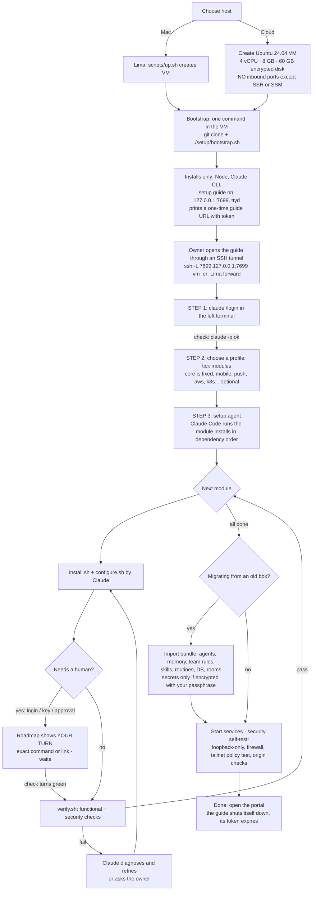

# agentbox: modular, portable setup (plan)

**Goal:** stand agentbox up on **any fresh Ubuntu VM** (the local Lima VM on the Mac, or a cloud VM)
from one bootstrap command, then a **guided setup page**:
- left side: a live **terminal** into the VM;
- right side: a **roadmap** that ticks itself off in real time as each step becomes true.

**Claude does the installing.** The human only does logins and approvals. Optional parts (the mobile
app, Firebase, voice, Kubernetes…) are **modules** you switch on or off. Nothing of a module is
installed or asked for unless it's enabled.

---

## 1. Principles
1. **Modules, not a monolith.** Each capability is a module described in a small manifest:
   what it needs, how to install it, how to check it, and which human step it requires. The same
   manifests drive the setup guide, the portal's health page and upgrades.
2. **Checks are the truth.** The roadmap advances only when a module's **check** passes, e.g.
   `gh auth status` succeeds. It never advances because someone, or Claude, says it's done.
3. **Humans do auth, Claude does the rest.** Every login, OAuth consent, key paste or admin
   approval is an explicit "your turn" gate. Everything else is automated and idempotent.
4. **Secure by default, wherever it runs:**
   - nothing listens on public interfaces;
   - the guide and portal are reachable only through an SSH tunnel or Tailscale;
   - secrets are never in the repo or in export bundles unless encrypted with your passphrase.
5. **The host is an adapter.** Everything specific to Lima (port forwards, the read-only repo mount,
   the external drive) sits behind a `host` adapter: `lima` or `cloud`. The rest of agentbox doesn't
   care where it runs.

## 2. Modules
| Module | Required | Depends on | Human gate (auth/approval) | Check (when green, the step is done) |
|---|---|---|---|---|
| **core**: Node, agentbox server, portal, systemd units, DB | ✔ | – | – | `curl 127.0.0.1:7700/api/health` → 200 |
| **claude**: Claude Code CLI + Agent SDK | ✔ | core | **`claude` → /login** (subscription) | `claude -p "ok"` returns text |
| **display**: Xvfb, window manager, VNC/noVNC, shared Chromium, screen lock | ✔ (recommended) | core | – | services active, CDP answers on 127.0.0.1:9222 |
| **terminal**: ttyd for the portal | ✔ | core | – | ttyd active, loopback only, origin check on |
| **github**: git, gh, team rules (`/team`), skills | optional | core | **`gh auth login`** (+ project scope) | `gh auth status` + scopes |
| **aws**: AWS CLI, SSM plugin | optional | core | **`aws configure sso`** or an instance role | `aws sts get-caller-identity` |
| **kubernetes**: kubectl, kubeconfig, `/team/kubernetes.md` | optional | aws | (choose cluster and access level) | `kubectl auth can-i get pods` |
| **db-tunnel**: `mongodb_tunnel_*`, `/secrets/db-tunnel.conf`, SSH key | optional | aws | **paste key and config** | `mongodb_tunnel_start && _status && _stop` |
| **env-files**: `/secrets/<repo>/*.env` | optional | – | **upload or paste** (or pull from Secrets Manager, if approved) | files present, 0600 |
| **teams-browser**: Teams login in the shared Chromium | optional | display | **sign in on the screen** | Teams page shows signed in |
| **voice**: GLM cleanup key (`/secrets/zai.env`) | optional | core | **paste the Z.ai key** | `POST /api/voice/clean` → `cleaned:true` |
| **mobile**: Tailscale, gateway on 7710, the tailnet firewall, the Devices page | optional | core | **`tailscale up` login**, **paste the tailnet policy** | node online, serve tailnet-only, funnel not allowed |
| **mobile-app**: build the APK with EAS | optional | mobile | **`eas login`** | build FINISHED, APK link |
| **push**: Firebase / FCM | optional | mobile-app | **create the Firebase project, `google-services.json`, upload the FCM key to Expo** | "Send test notification" delivered |
| **teams-bot** (backlog 15): Azure relay + Teams app | optional, later | github | **Entra app, Azure, Teams admin approval** | bot echo in the test channel |

Each module is a folder `setup/modules/<id>/` containing:
- `module.yaml`: id, title, description, `depends`, `optional`, the `gate` text for humans, `checks`, `files`, `units`;
- `install.sh` and `configure.sh`: idempotent, safe to re-run;
- `verify.sh`: the deeper verification, including security checks.

Disabled modules leave no traces: no packages, no units, no routes. For example, the gateway isn't
started, and the server sees `modules.mobile = false`.

## 3. The flow


In words:
1. **Provision.**
   - Mac: `scripts/up.sh` (Lima).
   - Cloud: create an Ubuntu 24.04 VM with an encrypted disk and **no inbound ports** apart from SSH,
     or none at all if you use AWS SSM.
2. **Bootstrap.** One command in the VM: `git clone … && ./setup/bootstrap.sh`. It installs only
   what the guide needs (Node, Claude CLI, the guide server, ttyd) and prints a **one-time URL with a
   token**.
3. **Open the guide** through an SSH tunnel (cloud) or Lima's localhost forward (Mac).
   - **Left:** the terminal.
   - **Right:** the roadmap.
4. **Step 1: Claude login,** done by you in the terminal. Its check runs `claude -p "ok"`; once it
   answers, the roadmap moves on.
5. **Step 2: choose a profile,** by ticking modules. Core is always on. Mobile, push, voice, AWS and
   Kubernetes are all optional. Picking "mobile app" pulls in Tailscale; picking "push" pulls in
   Firebase.
6. **Step 3: the setup agent.** A Claude Code session with the manifests installs modules one by one.
   Its output streams into the left terminal.
   - At each **gate** the roadmap shows **"Your turn"** with the exact command or link (e.g. run
     `gh auth login`, open the Tailscale login URL, paste the tailnet policy). It continues the moment
     that step's check passes.
   - Failures are diagnosed and retried; anything uncertain is asked.
7. **Optional migration import** (details below).
8. **Start services and run the security self-test:**
   - loopback-only listeners;
   - the firewall loaded;
   - a tailnet policy test (if mobile);
   - the terminal origin check;
   - secret file permissions.
9. **Done.** The portal opens; the guide stops and its token expires.

## 4. The guide page
```
┌─────────────────────────────── agentbox setup · host: cloud (ip-10-0-1-23) ───────────────────────────────┐
│ TERMINAL (live, VM shell)                         │ ROADMAP                                               │
│                                                   │  ✔ 1  Bootstrap                                       │
│ $ claude                                          │  ✔ 2  Claude login                                    │
│ > /login  …                                       │  ▶ 3  Profile: core, display, github, aws, mobile     │
│ Logged in as …                                    │  ● 4  core              installing… (Claude)          │
│                                                   │  ○ 5  display                                         │
│ [setup agent] installing core: node 22… ok        │  ⏸ 6  github  YOUR TURN: run `gh auth login`          │
│ [setup agent] writing units… ok                   │        [copy command]  · waiting for: gh auth status  │
│                                                   │  ○ 7  aws     (needs: SSO login or instance role)     │
│                                                   │  ○ 8  mobile  Tailscale login + tailnet policy        │
│                                                   │  ─ 9  push    (off: enable to set up Firebase)        │
│                                                   │  ○ 10 Security self-test                              │
│                                                   │  [Pause agent] [Re-check all] [Show logs]             │
└───────────────────────────────────────────────────┴───────────────────────────────────────────────────────┘
```
- **Real-time tracking:** the guide server runs each pending step's **check** every few seconds
  (cheap, read-only commands) and pushes changes over a WebSocket, so a step flips to ✔ the moment it
  becomes true, whoever did it.
- **States:** ○ pending · ● Claude working · ⏸ your turn · ✔ done · ✖ failed (with the reason and a
  Retry button) · ─ disabled.
- **Each "your turn" card** has a short explanation, the exact command or link to copy, and what's
  being waited for. Gates never ask for secrets in the chat: you type them in the terminal or the
  official login page.
- **Re-runnable:** opening the guide later shows the current state of every module, and the same page
  doubles as **Settings → Modules** to enable a module afterwards (e.g. add the mobile app later).

## 5. Migration (moving an existing agentbox)
- `agentbox export` produces a bundle of:
  - agent roles (CLAUDE.md, memory), `/team` rules, skills;
  - routines (with rules), groups and the DB (conversations, tasks, runs), room folders;
  - the profile (enabled modules).
- **Secrets are excluded by default.** Optionally include them encrypted with a passphrase (`age`).
- Paired phones **don't** move. Re-pair, because keys are tied to the old gateway URL.
- `agentbox import <bundle>` runs as a guide step. Repos in `/work` are re-cloned, not copied.

## 6. Refactors needed in the current code
1. **A single config** `/etc/agentbox/config.yaml`: enabled modules, host adapter, paths, ports. The
   server reads feature flags: no gateway, voice, push or Tailscale status unless enabled.
2. **The host adapter** replaces hard-coded Lima facts:
   - the repo mount `/mnt/agentbox-src` becomes "deploy from the local clone" on cloud;
   - `scripts/deploy.sh`, `start.sh` and `stop.sh` become host-aware;
   - the external drive path is configurable.
3. **Units and scripts per module:** systemd units move into their modules and are installed only when
   enabled (`install-units.sh` becomes module-driven).
4. **Check and verify scripts** are shared by the guide and the portal's health page.
5. **Remove the Mac-only assumptions** in the docs and scripts (zsh quirks, `limactl` calls).
6. **Security fixes from the audit become part of the modules** (e.g. the terminal module includes
   the origin check, the core module sets DB permissions and `UMask`), so a fresh setup is born
   hardened.

## 7. Cloud-specific choices (recommended defaults)
- **Access:** SSH tunnel for the guide and portal; or Tailscale for everything once the mobile module
  is on.
- **AWS:** if the VM runs in your AWS account, use an **instance role** with least privilege instead
  of long-lived keys. That fixes audit C1 by construction. On EC2: encrypted EBS, IMDSv2 only, a
  security group with no inbound (SSM Session Manager).
- **Size:** 4 vCPU and 8 GB RAM minimum (6 GB was tight); 60 GB disk.
- **Cost:** for example, a t4g.large (2 vCPU / 8 GB) is about $50/month on demand, or a
  c7g.xlarge / m7g.large for more headroom. Choose based on how many agents run at once.

## 8. Build order
1. Module manifests plus check/verify scripts for the modules that exist today (core, claude, display,
   terminal, github, aws, kubernetes, db-tunnel, env-files, voice, mobile, mobile-app, push), and the
   config file with server feature flags.
2. The host adapter (lima | cloud), with the deploy, start and stop scripts made host-aware.
3. The guide server and page: terminal + roadmap, live checks, gates, one-time token, loopback only.
4. The setup agent: a Claude Code session with the manifests, the "humans only for auth" rule, and
   resumability.
5. Export and import.
6. A dry run on a fresh Lima VM, then on a cloud VM. Fix everything the security self-test reports.

## 9. Decisions for the owner
1. **Cloud target:** AWS EC2 (instance role, SSM, no SSH), another cloud, or "any Ubuntu VM over SSH"?
2. **Access to the guide and portal on cloud:** SSH tunnel (simplest) or Tailscale-first?
3. **Migration:** move this install's data (agents, memory, routines, history) to the new VM, or start
   fresh with only roles, rules and skills?
4. **Secrets in migration:** re-enter on the new box (safest), or an encrypted bundle?
