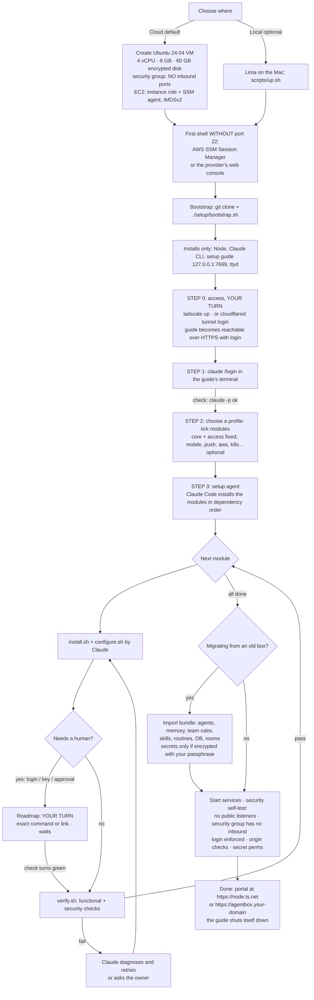

# agentbox: modular, portable setup (plan)

**Goal:** stand agentbox up on **any fresh Ubuntu VM** from one bootstrap command, then a
**guided setup page**:
- left side: a live **terminal** into the VM;
- right side: a **roadmap** that ticks itself off in real time as each step becomes true.

**Claude does the installing.** The human only does logins and approvals. Optional parts (the mobile
app, Firebase, voice, Kubernetes…) are **modules** you switch on or off. Nothing of a module is
installed or asked for unless it's enabled.

---

## 1. Principles
1. **Modules, not a monolith.** Each capability is a module described in a small manifest:
   what it needs, how to install it, how to check it, and which human step it requires. The same
   manifests drive the setup guide, the portal's health page and upgrades.
2. **Checks are the truth.** The roadmap advances only when a module's **check** passes, e.g.
   `gh auth status` succeeds. It never advances because someone, or Claude, says it's done.
3. **Humans do auth, Claude does the rest.** Every login, OAuth consent, key paste or admin
   approval is an explicit "your turn" gate. Everything else is automated and idempotent.
4. **Secure by default, wherever it runs:**
   - nothing listens on public interfaces;
   - the guide and portal are reachable only through an SSH tunnel or Tailscale;
   - secrets are never in the repo or in export bundles unless encrypted with your passphrase.
5. **The VM is the whole system and the isolation boundary.** On a cloud VM everything lives there:
   agents, services, repos, work. **No Lima and no Mac involvement.** Lima remains only as an
   optional *local* host for running it on the Mac. Host-specific bits (local: Lima port forwards and
   the read-only repo mount; cloud: none) sit behind a `host` adapter, `cloud` (the default) or `lima`.
6. **No inbound ports.** The portal, terminal, screen and phone gateway are reached through an
   **access module** that needs no open ports and adds a real login (section 2a). Never plain HTTP,
   and never an unauthenticated portal on the internet.

## 2. Modules
| Module | Required | Depends on | Human gate (auth/approval) | Check (when green, the step is done) |
|---|---|---|---|---|
| **core**: Node, agentbox server, portal, systemd units, DB | ✔ | – | – | `curl 127.0.0.1:7700/api/health` → 200 |
| **claude**: Claude Code CLI + Agent SDK | ✔ | core | **`claude` → /login** (subscription) | `claude -p "ok"` returns text |
| **display**: Xvfb, window manager, VNC/noVNC, shared Chromium, screen lock | ✔ (recommended) | core | – | services active, CDP answers on 127.0.0.1:9222 |
| **terminal**: ttyd for the portal | ✔ | core | – | ttyd active, loopback only, origin check on |
| **github**: git, gh, team rules (`/team`), skills | optional | core | **`gh auth login`** (+ project scope) | `gh auth status` + scopes |
| **aws**: AWS CLI, SSM plugin | optional | core | **`aws configure sso`** or an instance role | `aws sts get-caller-identity` |
| **kubernetes**: kubectl, kubeconfig, `/team/kubernetes.md` | optional | aws | (choose cluster and access level) | `kubectl auth can-i get pods` |
| **db-tunnel**: `mongodb_tunnel_*`, `/secrets/db-tunnel.conf`, SSH key | optional | aws | **paste key and config** | `mongodb_tunnel_start && _status && _stop` |
| **env-files**: `/secrets/<repo>/*.env` | optional | – | **upload or paste** (or pull from Secrets Manager, if approved) | files present, 0600 |
| **teams-browser**: Teams login in the shared Chromium | optional | display | **sign in on the screen** | Teams page shows signed in |
| **voice**: GLM cleanup key (`/secrets/zai.env`) | optional | core | **paste the Z.ai key** | `POST /api/voice/clean` → `cleaned:true` |
| **access**: how you reach the VM (tailscale \| cloudflare \| ssm \| ssh-tunnel), plus the portal login | ✔ | core | **`tailscale up` login** / **`cloudflared` login + Access policy** / IAM | portal reachable via the chosen mode with login enforced; nothing listening publicly |
| **mobile**: gateway on 7710, Devices page, tailnet firewall (needs access = tailscale) | optional | access | **paste the tailnet policy** (tag, port 443 only) | serve tailnet-only, funnel not allowed, policy test passes |
| **mobile-app**: build the APK with EAS | optional | mobile | **`eas login`** | build FINISHED, APK link |
| **push**: Firebase / FCM | optional | mobile-app | **create the Firebase project, `google-services.json`, upload the FCM key to Expo** | "Send test notification" delivered |
| **teams-bot** (planned): Azure relay + Teams app | optional, later | github | **Entra app, Azure, Teams admin approval** | bot echo in the test channel |

### 2a. Access: reaching the VM without opening ports
The portal drives agents that hold production access, so it must never sit on a public port
without a login. Open ports also get scanned within minutes. Every option below needs **zero
inbound ports** (port 22 included) and gives **HTTPS + identity**:

| Access mode | Portal (browser) | Terminal (shell) | Login / identity | Needs | Recommended for |
|---|---|---|---|---|---|
| **tailscale** (default) | `https://<node>.ts.net` via `tailscale serve` (tailnet only) | the portal's terminal, or **Tailscale SSH** (no port 22) | Tailscale identity (the owner's login; checked from `Tailscale-User-Login`) | free Tailscale account, the client on your devices | You alone, from your devices; also covers the phone app |
| **cloudflare** | `https://agentbox.<your-domain>` via **Cloudflare Tunnel** (outbound only) | **browser SSH** through Cloudflare Access, or the portal's terminal | **Cloudflare Access** in front (SSO or email OTP, MFA, allow only your email), and agentbox verifies the Access JWT | a domain on Cloudflare (free plan) | Opening from any browser without a VPN client; sharing with teammates later |
| **cloud-native** (AWS) | port forward over **SSM Session Manager** (`aws ssm start-session … AWS-StartPortForwardingSession`) | **SSM Session Manager shell** (no port 22, no keys) | AWS IAM (+ MFA) | the VM on EC2 with the SSM agent and an instance role | Admin and break-glass access; works even if Tailscale or Cloudflare is down |
| ssh-tunnel (fallback) | `ssh -L 7700:127.0.0.1:7700 vm` | ssh | SSH key | **port 22 open** (restricted to your IP) | Only if none of the above is possible |

- **Recommended:** **tailscale** as the main way in (portal, terminal, phone app), plus **SSM** as the
  emergency way in. That means **no inbound ports at all**: the cloud firewall / security group allows
  nothing in.
- **Port 80/443 public** is only acceptable through **cloudflare** mode, where nothing on the VM
  listens publicly (the tunnel is outbound) and Cloudflare Access enforces login before any request
  reaches the VM.
- **The portal gets an auth layer** when not used from localhost. The access module sets the trusted
  identity source (Tailscale header, or the Cloudflare Access JWT) and the allowed host and origin;
  `guardApi` uses that config instead of "loopback only". The CSRF and Origin protections stay.
- **The terminal** stays behind the same login, with the origin check (the cross-site
  terminal access finding of the security review is fixed by construction).

Each module is a folder `setup/modules/<id>/` containing:
- `module.yaml`: id, title, description, `depends`, `optional`, the `gate` text for humans, `checks`, `files`, `units`;
- `install.sh` and `configure.sh`: idempotent, safe to re-run;
- `verify.sh`: the deeper verification, including security checks.

Disabled modules leave no traces: no packages, no units, no routes. For example, the gateway isn't
started, and the server sees `modules.mobile = false`.

## 3. The flow


In words:
1. **Provision a cloud VM:** Ubuntu 24.04, encrypted disk, and a firewall / security group with **no
   inbound rules**.
   - On AWS: an instance role (least privilege) and the SSM agent.
   - Lima on the Mac stays possible as a local option.
2. **First shell without port 22:**
   - AWS: **SSM Session Manager**, a shell in the browser or from `aws ssm start-session`;
   - other providers: their web serial console.
3. **Bootstrap.** One command: `git clone … && ./setup/bootstrap.sh`. It installs only what the
   guide needs (Node, Claude CLI, the guide server, ttyd).
4. **Step 0, access (your turn):**
   - `tailscale up` and log in (recommended), **or** log in to `cloudflared` and attach a Cloudflare
     Access policy (your email only).
   - The guide then opens at `https://<node>.ts.net` or `https://agentbox.<domain>`, behind the
     login. **Left:** the terminal; **right:** the roadmap. (Until then, `ssm start-session`
     port-forwarding can open it.)
5. **Step 1: Claude login,** done by you in the terminal. Its check runs `claude -p "ok"`; once it
   answers, the roadmap moves on.
6. **Step 2: choose a profile,** by ticking modules. Core is always on. Mobile, push, voice, AWS and
   Kubernetes are all optional. Picking "mobile app" pulls in Tailscale; picking "push" pulls in
   Firebase.
7. **Step 3: the setup agent.** A Claude Code session with the manifests installs modules one by one.
   Its output streams into the left terminal.
   - At each **gate** the roadmap shows **"Your turn"** with the exact command or link (e.g. run
     `gh auth login`, open the Tailscale login URL, paste the tailnet policy). It continues the moment
     that step's check passes.
   - Failures are diagnosed and retried; anything uncertain is asked.
8. **Optional migration import** (details below).
9. **Start services and run the security self-test:**
   - nothing listening on public interfaces, and the security group has no inbound rules;
   - the login enforced on the portal and terminal;
   - the firewall loaded;
   - a tailnet policy test (if mobile);
   - the terminal origin check;
   - secret file permissions.
10. **Done.** The portal opens at its HTTPS address; the guide stops.

## 4. The guide page
```
┌─────────────────────────────── agentbox setup · host: cloud (ip-10-0-1-23) ───────────────────────────────┐
│ TERMINAL (live, VM shell)                         │ ROADMAP                                               │
│                                                   │  ✔ 1  Bootstrap                                       │
│ $ claude                                          │  ✔ 2  Claude login                                    │
│ > /login  …                                       │  ▶ 3  Profile: core, display, github, aws, mobile     │
│ Logged in as …                                    │  ● 4  core              installing… (Claude)          │
│                                                   │  ○ 5  display                                         │
│ [setup agent] installing core: node 22… ok        │  ⏸ 6  github  YOUR TURN: run `gh auth login`          │
│ [setup agent] writing units… ok                   │        [copy command]  · waiting for: gh auth status  │
│                                                   │  ○ 7  aws     (needs: SSO login or instance role)     │
│                                                   │  ○ 8  mobile  Tailscale login + tailnet policy        │
│                                                   │  ─ 9  push    (off: enable to set up Firebase)        │
│                                                   │  ○ 10 Security self-test                              │
│                                                   │  [Pause agent] [Re-check all] [Show logs]             │
└───────────────────────────────────────────────────┴───────────────────────────────────────────────────────┘
```
- **Real-time tracking:** the guide server runs each pending step's **check** every few seconds
  (cheap, read-only commands) and pushes changes over a WebSocket, so a step flips to ✔ the moment it
  becomes true, whoever did it.
- **States:** ○ pending · ● Claude working · ⏸ your turn · ✔ done · ✖ failed (with the reason and a
  Retry button) · ─ disabled.
- **Each "your turn" card** has a short explanation, the exact command or link to copy, and what's
  being waited for. Gates never ask for secrets in the chat: you type them in the terminal or the
  official login page.
- **Re-runnable:** opening the guide later shows the current state of every module, and the same page
  doubles as **Settings → Modules** to enable a module afterwards (e.g. add the mobile app later).

## 5. Migration (moving an existing agentbox)
- `agentbox export` produces a bundle of:
  - agent roles (CLAUDE.md, memory), `/team` rules, skills;
  - routines (with rules), groups and the DB (conversations, tasks, runs), room folders;
  - the profile (enabled modules).
- **Secrets are excluded by default.** Optionally include them encrypted with a passphrase (`age`).
- Paired phones **don't** move. Re-pair, because keys are tied to the old gateway URL.
- `agentbox import <bundle>` runs as a guide step. Repos in `/work` are re-cloned, not copied.

## 6. Refactors needed in the current code
1. **A single config** `/etc/agentbox/config.yaml`: enabled modules, host adapter, paths, ports. The
   server reads feature flags: no gateway, voice, push or Tailscale status unless enabled.
2. **The host adapter** (`cloud` default, `lima` optional) replaces hard-coded Lima facts:
   - on cloud, the repo is cloned **on the VM** and deploys run there (`git pull` + build + restart);
     no `/mnt/agentbox-src`, `limactl` or Mac scripts;
   - the start, stop and deploy scripts run inside the VM (a systemd target);
   - on the Mac they become thin wrappers only for the Lima option.
3. **Portal auth and access config:** replace "loopback only" with the access module's config
   (trusted identity header or Cloudflare Access JWT verification, allowed host and origin), plus a
   session for the owner. The phone gateway keeps its signed-request model.
4. **Units and scripts per module:** systemd units move into their modules and are installed only when
   enabled (`install-units.sh` becomes module-driven).
5. **Check and verify scripts** are shared by the guide and the portal's health page.
6. **Remove the Mac-only assumptions** in the docs and scripts (zsh quirks, `limactl` calls).
7. **Security fixes from the audit become part of the modules** (e.g. the terminal module includes
   the origin check, the core module sets DB permissions and `UMask`), so a fresh setup is born
   hardened.

## 7. Cloud-specific choices (recommended defaults)
- **Access:** **Tailscale** (portal, terminal, phone) plus **SSM** as the emergency way in. **No
  inbound ports, not even 22.** Choose Cloudflare Tunnel + Access instead if you want to open the
  portal from any browser without a VPN client.
- **AWS:** if the VM runs in your AWS account, use an **instance role** with least privilege instead
  of long-lived keys. That fixes audit C1 by construction. On EC2: encrypted EBS, IMDSv2 only, a
  security group with no inbound (SSM Session Manager).
- **Size:** 4 vCPU and 8 GB RAM minimum (6 GB was tight); 60 GB disk.
- **Cost:** for example, a t4g.large (2 vCPU / 8 GB) is about $50/month on demand, or a
  c7g.xlarge / m7g.large for more headroom. Choose based on how many agents run at once.

## 8. Build order
1. Module manifests plus check/verify scripts for the modules that exist today (core, claude, display,
   terminal, github, aws, kubernetes, db-tunnel, env-files, voice, mobile, mobile-app, push), and the
   config file with server feature flags.
2. The host adapter (cloud | lima), deploy-on-VM, and the access module (tailscale, cloudflare, ssm)
   with portal auth.
3. The guide server and page: terminal + roadmap, live checks, gates, one-time token, loopback only.
4. The setup agent: a Claude Code session with the manifests, the "humans only for auth" rule, and
   resumability.
5. Export and import.
6. A dry run on a fresh Lima VM, then on a cloud VM. Fix everything the security self-test reports.

## 9. Decisions for the owner
1. **Cloud target:** AWS EC2 (instance role, SSM, no SSH), another cloud, or "any Ubuntu VM over SSH"?
2. **Access mode:** Tailscale + SSM (recommended; zero inbound ports), or Cloudflare Tunnel +
   Access (a public HTTPS URL behind login; still zero inbound ports)? Plain port 80 and port 22 are
   **not recommended**, as explained in 2a.
3. **Migration:** move this install's data (agents, memory, routines, history) to the new VM, or start
   fresh with only roles, rules and skills?
4. **Secrets in migration:** re-enter on the new box (safest), or an encrypted bundle?
